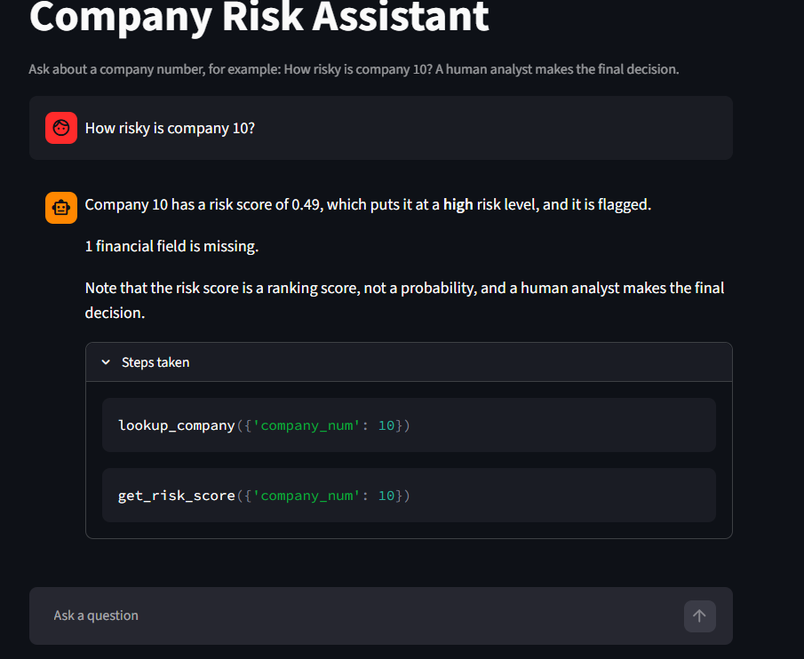
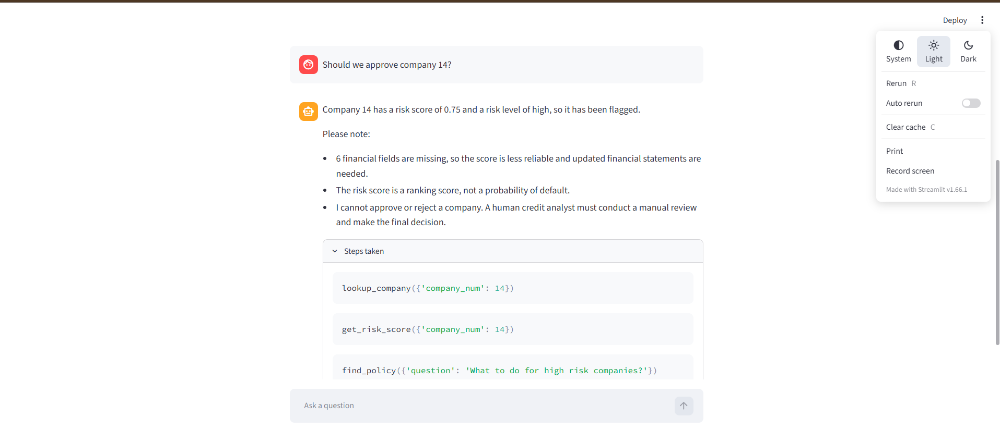
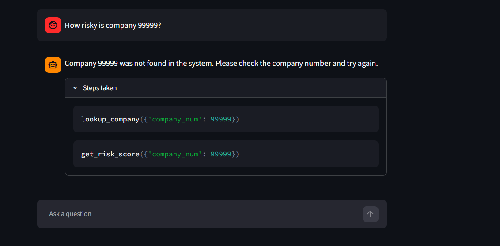

# Company Risk Assistant
**Live demo:** https://company-risk-agent-7gwzljfrbw2kwgflgueckd.streamlit.app

An AI agent that helps a credit analyst check how risky a company is. It decides by itself which tool to use, gets the facts from the tools, and explains the result in simple words. It never approves or rejects a company: a human analyst makes the final decision.

## What it does

Ask a question like "How risky is company 10?" and the agent:

1. Looks up the company's key financial figures.
2. Runs a trained default-risk model to get a risk score.
3. Searches the risk policy for the rule that applies.
4. Writes a short answer and shows which tools it used.

## Screenshots





## How it works

```
Question -> Gemini (function calling) -> picks tools -> answer
                                          |
        lookup_company   get_risk_score   find_policy
        (company data)   (ML model)       (policy.txt)
```

| File | Purpose |
|---|---|
| `train_model.py` | Trains and saves the default-risk model |
| `improve_model.py` | Compares 3 models with cross-validation |
| `tools.py` | The three tools: company lookup, risk score, policy search |
| `agent.py` | Gemini agent that chooses the tools and writes the answer |
| `app.py` | Streamlit chat screen |
| `eval.py` | Tests whether the agent chooses the right tools on 20 questions |
| `policy.txt` | Sample risk policy used by the policy search |

## The model

- Data: financial data of 3,541 companies with 52 columns. The target is "default", defined as next year's net worth at or below zero. About 7% of companies are defaults.
- Pipeline: KNN imputer for missing values, then a Random Forest with class weighting.
- Compared with a Random Forest using SMOTE and with gradient boosting, using 5-fold cross-validation. Class weighting scored best on PR-AUC.
- Decision threshold of 0.43, chosen with cross-validation on the training data only.

Results on a held-out test set of 886 companies (61 defaults):

| Metric | Value |
|---|---|
| ROC-AUC | 0.942 |
| PR-AUC | 0.614 |
| Precision (default class) | 0.63 |
| Recall (default class) | 0.62 |

Accuracy is not used as the main metric because defaults are rare, so a model that predicts "no default" for everyone would already look accurate.

## Agent testing

I wrote 20 test questions covering company questions, policy questions, an unknown company, a missing company number, and off-topic questions. The agent called the right tools in 20 of 20.

This is a small test written by me. It checks that the needed tools were called, not the quality of the written answer.

## Safety rules in the agent

- Numbers come only from the tools. The agent is told never to invent data.
- It never approves or rejects a company.
- It says so when a company is not found or no policy matches.
- It asks for a company number when none is given.
- It warns that the score is less reliable when many financial fields are missing.
- It tries other Gemini models if one is busy.

## Limitations

- The policy in `policy.txt` is a sample I wrote for this project. It is not a real company policy.
- The model finds about 6 in 10 real defaults, so it supports an analyst and does not replace one.
- The risk score is a ranking score, not an exact probability.
- The test set for the agent is small.

## How to run

1. Install the libraries: `pip install -r requirements.txt`
2. The dataset (`Company data.csv`) is included for the demo. It is a public dataset.
3. 3. Create a file named `key.txt` with your own Gemini API key on one line.
4. Train the model: `python train_model.py`
5. Start the app: `python -m streamlit run app.py`

## Tech

Python, pandas, scikit-learn, Google Gemini API (function calling), Streamlit.

## Author

Shraddha Nimbalkar
